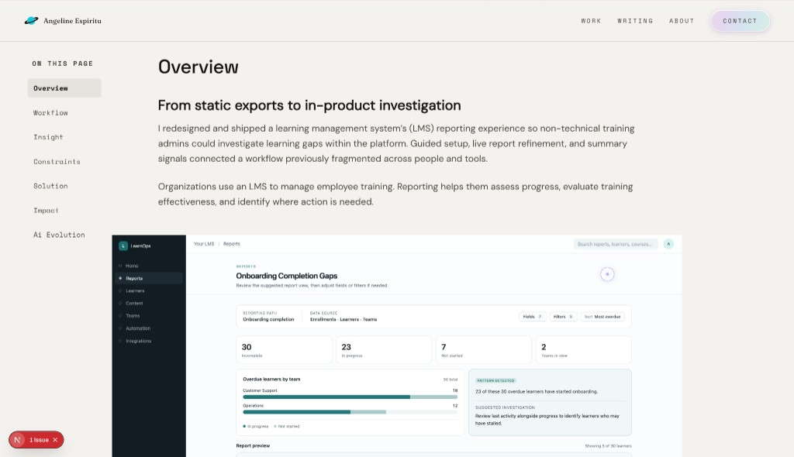
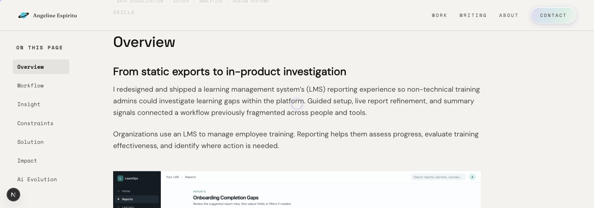
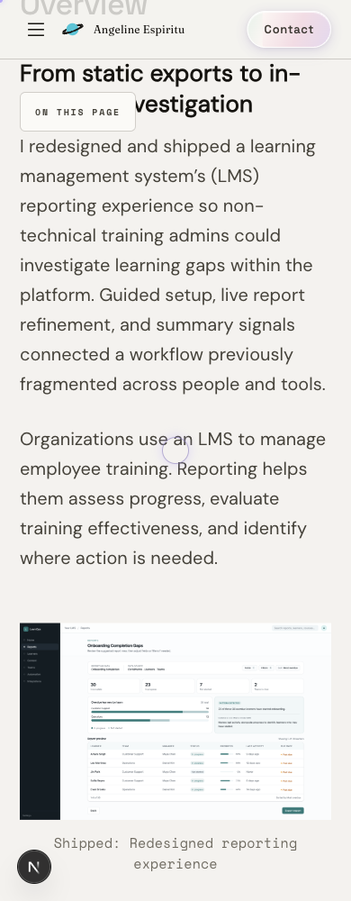
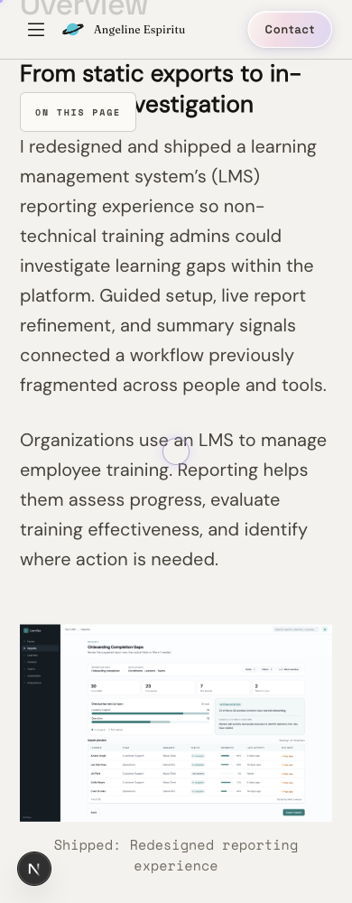
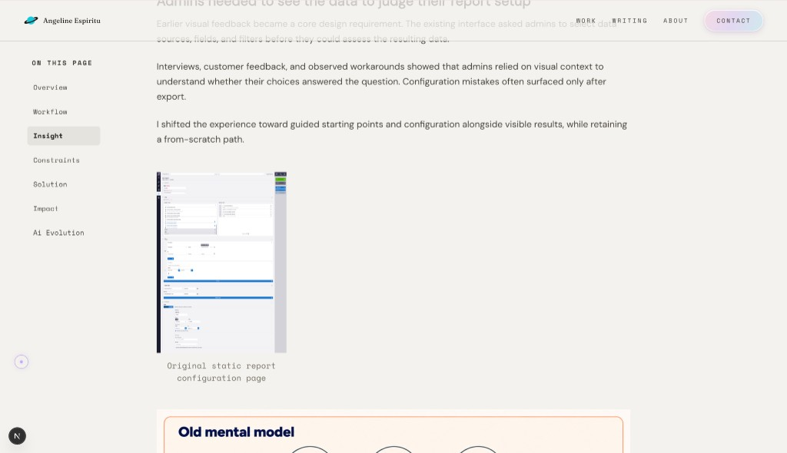
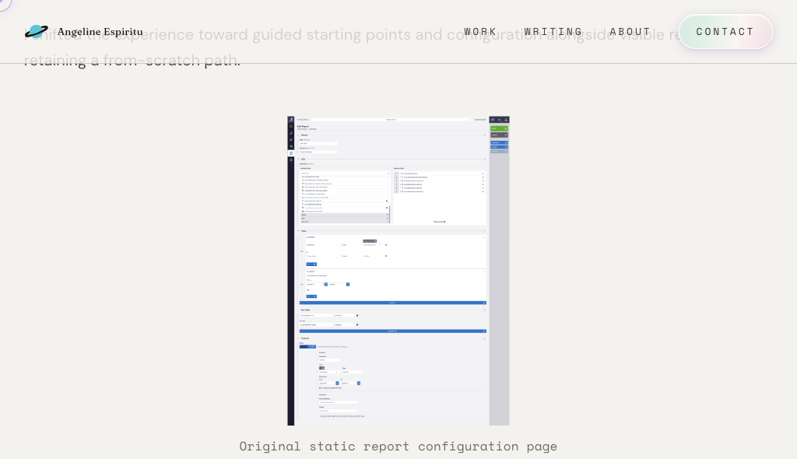
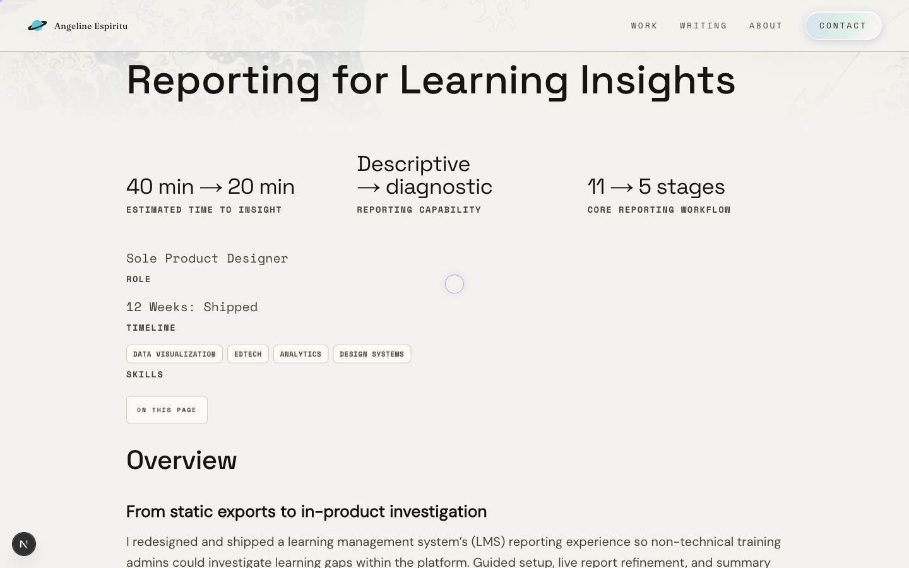

# Refining the case-study reading experience

## What I saw

On the Reporting case study, the paragraphs already formed a reading column. The figures, captions, title, and project details did not, so the page did not read as one piece.

Standard images ran wider than the text, and their captions sat on the left. Compact screenshots kept the caption beside the image. A later pass centered that caption by narrowing it to the screenshot, so a short sentence stacked into a few words a line. The introduction used another arrangement: a centered title, outcome columns sized to their words, and Role, Timeline, and Skills side by side, with the label above the value.

The prototype I had placed in Notion, under “Explore the workflow,” was missing from the page. I could not judge that part of the section in context.

## What I decided

I brought the figures, captions, title, and introductory information onto the existing reading column. Articles kept their own treatment.

Captions are centered across the column, including under compact images. Those images stay small and can still be enlarged. The title aligns with the paragraph. Outcomes remain three columns while they read comfortably, then stack. I bottom-aligned the outcome pairs so their labels line up without opening gaps beneath shorter values. Role, Timeline, and Skills are one list at every width, value or tags first.

## How I used AI

I used Cursor to trace visual inconsistencies to the underlying layout rules, implement focused changes, and check the rendered results.

One implementation put the outcome and project-context labels on a shared line. The columns matched, but Role and Timeline had separated from their values to meet the lowest label. I rejected it. A label belongs with its value.

I asked Cursor to trace a spacing conflict before I changed it. An older mobile rule looked as if it tightened the section padding, but a later rule was already what the page rendered. I removed the ineffective rule and kept the spacing I had approved.

I also asked Cursor to follow the missing prototype from the new case-study database to the page. Rendering the Notion embed, and replacing the project-editor URL with the published app URL, resolved it.

## What I verified

### Wide window

Before.

After.

### Narrow window

Before.

After.

### Compact caption

Intermediate: the caption was constrained to the small image.

After: the image stays compact while its caption uses the reading column.

Cursor checked the rendered page across desktop, tablet, and mobile viewport widths. The spacing I had approved held, and the page did not scroll sideways. I enlarged a compact image, closed it with Escape and scrolled, and opened, closed, and used the contents navigation.

The published prototype loads beneath “Explore the workflow.”

Matching widths was not the whole judgment. I still had to decide how the overview prose and the reporting figure read together, and the title block above sets the same problem at a larger scale: outcomes, labels, and tags have to feel like one introduction, not separate bands. Typography is the next pass, and changes to font metrics and wrapping may pull spacing and responsive layout back into question—starting with the block in this frame.
