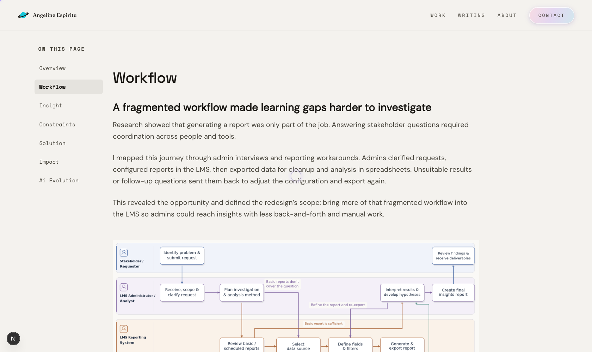
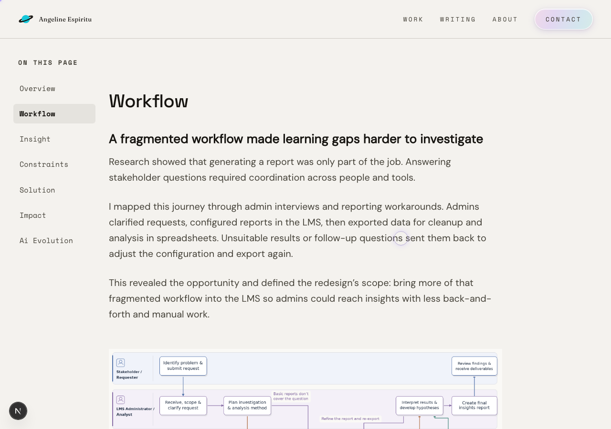
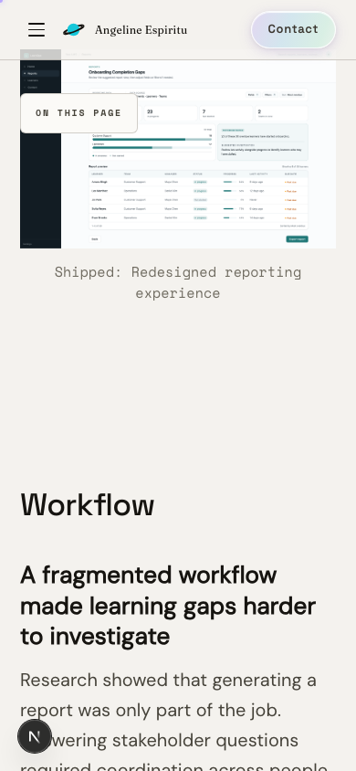
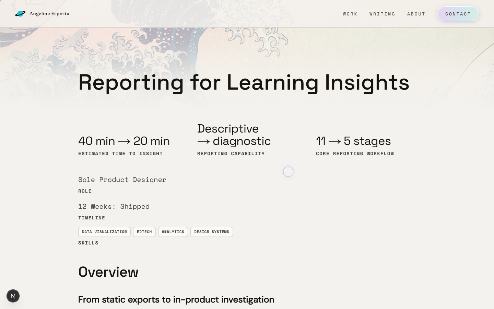

# Refining the case-study reading experience

## What I saw

The Reporting case study felt visually unbalanced. There was more space on the right than the reading needed, and I wanted a more centered, coherent page.

I asked Cursor to measure the layout before I moved the body. The column was already centered. The side list was positioned against a separate, wider rail, so it sat far from the text while the right side stayed open.

The figures had already been a separate problem. Standard images ran wider than the paragraphs, and captions sat on the left. Compact screenshots stayed small, but centering the caption by narrowing it to the image made a short sentence stack into a few words a line. The introduction used its own arrangement: a centered title, outcome columns sized to their words, and Role, Timeline, and Skills side by side.

The prototype under “Explore the workflow” section was missing, so I could not judge that part of the section in context.

## What I decided

**I wanted the layout to stay balanced without JavaScript repeatedly measuring and repositioning it. I used CSS to express the relationship between the reading column and the TOC, while keeping JavaScript for navigation and interaction. I removed the superseded measurements and rules, then checked the homepage and an article to make sure the shared navigation styles still worked as expected.**  
  
**Supporting decisions I took:**  
I brought the side list closer to the reading column and kept the column’s equal margins. In my visual review, the navigation and the content felt connected. Moving the list did not center the column. The column was already centered.

Separately, I challenged the side list disappearing below 1680px. The revised layout keeps it down to 1246px, where the side margin can still hold it. Below that, the page uses the compact “On this page” control. Anchoring the list did not set that breakpoint.

Standard figures now share the prose column. Compact images stay small and can still be enlarged. Their captions are centered and use the reading-column width.

The introduction sits on that same column. The title lines up with the paragraph. The three outcomes stay in a row, then stack at 840px, with each label aligned to the bottom of its value. Role, Timeline, and Skills are one list, value or tags first. I rejected a shared-label arrangement because Role and Timeline had separated from their values. I also removed a mobile spacing rule that a later rule had already replaced. The spacing I had approved stayed.

Tracing the missing prototype showed that the renderer discarded embed blocks. Supporting those blocks, and using the published app URL, put the prototype back under “Explore the workflow.”

## What I checked

**Earlier** Overview frame.** The figure runs wider than the paragraphs, and the side list sits well to the left of the text. This file is 1024×590 pixels. I do not have a later capture of this same frame at the same size, so I am not treating it as the same window as the Workflow frames below.

**Current** Workflow section, 1680×1000. The paragraphs and the diagram share one width. The side list sits beside the column, with open space on both sides of that column.

**Current** Workflow section, 1280×900. The side list is still beside the column below 1680px.

Narrow window, **current**. The figure and its centered caption sit in the reading column, and the compact control is the navigation.

Compact caption, an **intermediate** step. The caption was limited to the small image.

**After** that step. The image stays small. The caption is centered on the reading column.

The title, outcomes, and project details are in place. Typography is the **next** pass. A change in type can alter line length and wrapping, so I expect to review this layout again.

