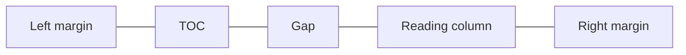

# Refining case-study typography with a live comparison tool

[Refining the case-study reading experience](https://github.com/angelineespiritu/portfolio-build-log/blob/main/examples/case-study-reading-column/README.md) established a centered reading column with the side TOC beside it.

## I built a switch to compare type on the same page

I asked Cursor to build a Current / Proposed switch in the local preview. I used it to judge how the title, headings, outcomes, labels, and body copy worked together. I started with the case studies and drew from fonts already used across the site.

## Fraunces leads the title. DM Sans carries the reading.

Once I saw Fraunces and Space Grotesk together in the preview, they felt like they were pulling the page in different directions. I gave Fraunces the title and moved the section headings and outcome values to DM Sans, which already carried the body copy.

| Typeface | Role in the Proposed case study |
|---|---|
| Fraunces | Case-study title. Reuses the homepage display face and gives the title a distinct voice. |
| DM Sans | Section headings, body copy, outcome values, and Role and Timeline values. Gives the main reading elements a consistent voice. |
| Space Mono | Labels, skill pills, and side TOC. Makes supporting details and navigation easy to spot. |
| Space Grotesk | Removed from the Proposed case-study typography. DM Sans takes over its roles in section headings and outcome values. |

Reusing the site’s existing font palette kept this pass lean.

## The columns were equal. The copy made them look uneven.

I asked Cursor to inspect the grid. The three columns were already equal, and I kept those proportions while tightening the copy. In the middle column, ‘Diagnostic’ names the capability in one word, and ‘Reporting capability’ gives it context. The pair is easy to scan alongside the two numeric results.

## Shorter copy and tighter spacing kept the full TOC visible at 1200px

With the full TOC visible at 1200px, ‘40 min → 20 min’ wrapped. After I shortened it to ‘40 → 20 min’ and tightened the column spacing, I verified that all three outcome values fit on one line and the reading column stayed centered.

Both previews use the revised outcome copy. Compare the title, outcome typography, and project context.

Current

Proposed

How the desktop TOC sits beside the reading column.

The larger break before Overview marks the start of the main case study, and Skills sits beside Role and Timeline when the pills fit, moving below when the space is tighter.
