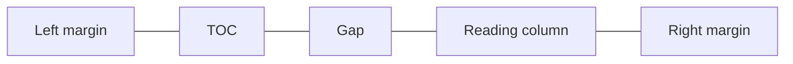
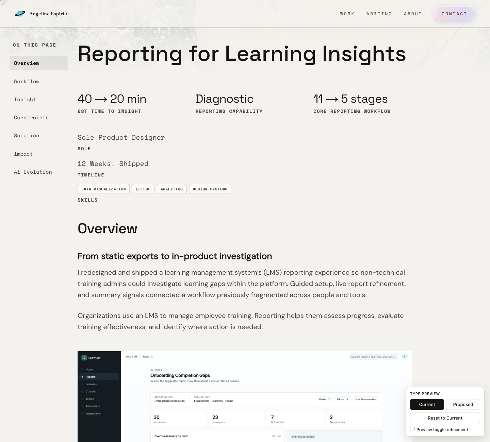
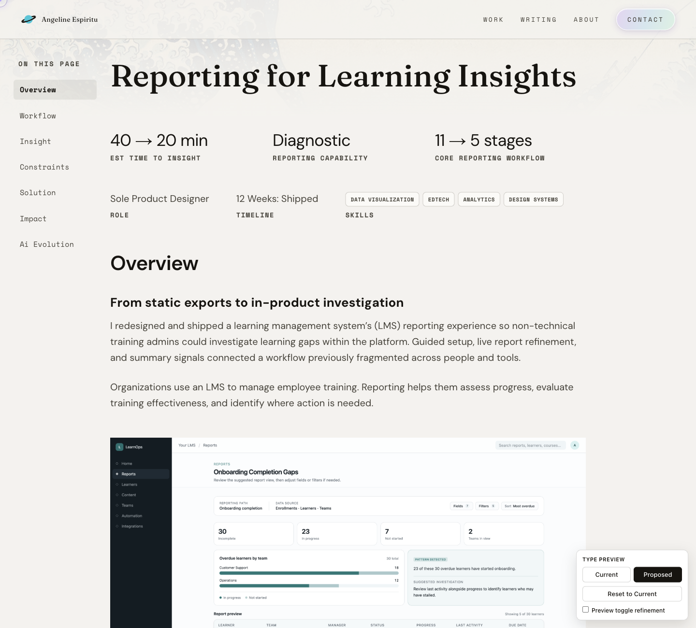

# Refining case-study typography with a live comparison tool

[Refining the case-study reading experience](https://github.com/angelineespiritu/portfolio-build-log/blob/main/examples/case-study-reading-column/README.md) established a centered reading column with the side TOC beside it.

I asked Cursor to build a Current / Proposed switch in the local preview so I could judge how the title, headings, outcomes, and labels worked together alongside the body copy on the same page. I started with case studies and drew from fonts already used across the site.

Fraunces, already used for display type on the homepage, gives the case-study title a distinct voice. I extended DM Sans from body copy to section headings, outcome values, and the Role and Timeline values. Space Mono continues to distinguish labels, skills pills, and the side TOC. Reusing the site’s existing fonts kept the typography pass lean.

The outcome row looked uneven, so I asked Cursor to inspect the grid. The three columns were already equal, and I kept those proportions while tightening the copy. In the middle column, ‘Diagnostic’ names the capability in one word, and ‘Reporting capability’ gives it context. The pair is easy to scan alongside the two numeric results.

The larger break before Overview marks the start of the main case study. Skills sits beside Role and Timeline when the pills fit, and moves below when the space is tighter.

I wanted to keep the full side TOC visible on smaller desktops. I asked Cursor to test the existing layout at 1200px, where the longest outcome wrapped with the full TOC visible. With shorter outcome copy and tighter column spacing, I checked that all three outcomes fit on one line at that width and the reading column stayed centered.

How the desktop TOC sits beside the reading column.

Compare the title, outcome values, and project context in the same desktop view.

Current

Proposed

