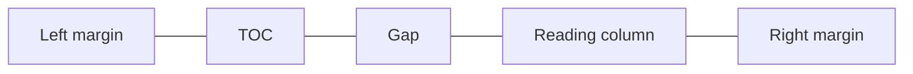

# Refining case-study typography with a live comparison tool

[Refining the case-study reading experience](https://github.com/angelineespiritu/portfolio-build-log/blob/main/examples/case-study-reading-column/README.md) established a centered reading column with the side TOC beside it.

## I audited the site’s typography before changing it

I checked the homepage, the published case study, and an article before I changed any type.

| Typeface | Where it was used before this pass | What it did |
|---|---|---|
| Fraunces | Homepage hero, name, contact heading, and writing-card titles. The nav wordmark on the homepage and case studies. | Display type, and the name in the navigation. |
| DM Sans | Case-study body, subsection headings, tables, and the next-study title. Article excerpts and sidebar notes. | Reading text on case studies, and the shorter text around an article. |
| Space Grotesk | Case-study titles, section headings, and outcome values. Homepage about text, work titles, and the shared “Work with me” button. | The sans used for case-study display lines and homepage interface text. |
| Space Mono | Case-study labels, skill pills, Role and Timeline values, and the table of contents. Homepage section labels, indexes, and links. | Small labels and navigation. |
| Cormorant Garamond | Article titles and drop caps. | Display type for articles. |
| Libre Caslon Text | Article prose. | The reading face for articles. |

I started with the case studies and used this existing palette as the starting point for the live comparison.

## I built a switch to compare type on the same page

I asked Cursor to build the switch in the local preview so I could judge how the title, headings, outcomes, labels, and body copy worked together on the same case-study page.

## Fraunces leads the title. DM Sans carries the reading.

Seeing Fraunces and Space Grotesk together helped me decide that they pulled the page in different directions. I gave Fraunces the title, extended DM Sans from body copy to headings and values, and kept Space Mono for labels, skill pills, and navigation.

| Typeface | Role in the Proposed case study |
|---|---|
| Fraunces | Case-study title. Reuses the homepage display face and gives the title a distinct voice. |
| DM Sans | Section headings, body copy, outcome values, and Role and Timeline values. Gives the main reading elements a consistent voice. |
| Space Mono | Labels, skill pills, and side TOC. Makes supporting details and navigation easy to spot. |
| Space Grotesk | Removed from the Proposed case-study typography. DM Sans takes over its roles in section headings and outcome values. |

Reusing the site’s existing font palette kept this pass lean.

## The columns were equal. The copy made them look uneven.

The outcome row looked uneven, so I asked Cursor to inspect the grid. The three columns were already equal. I kept those proportions and adjusted the wording. In the middle column, “Diagnostic” names the capability, and “Reporting capability” gives it context alongside the two numeric results.

## The full TOC stayed visible at 1200px

I tested the Proposed layout at 1200px because I wanted the full side TOC to remain useful on smaller desktops. With it visible, the longest outcome value wrapped. I checked the revised copy and column spacing together and verified that all three outcome values fit on one line, with the full TOC visible and the reading column still centered.

Compare how the title, outcomes, and project context read in each treatment.

Current

Proposed

How the desktop TOC sits beside the reading column.

## What’s next

My priority is to improve how the case studies present the work. I’ll finish revising the case-study content, then push the light theme, reading layout, and typography together as one update. In a later pass, I’ll review the homepage and article pages for consistency.
