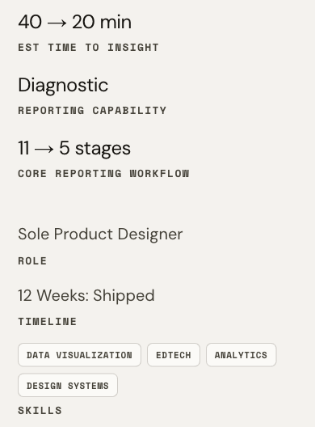
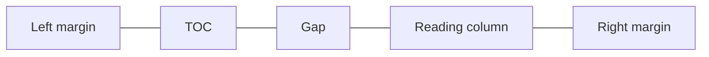

# Refining case-study typography with a live comparison tool

[Refining the case-study reading experience](https://github.com/angelineespiritu/portfolio-build-log/blob/main/examples/case-study-reading-column/README.md) established a centered reading column with the side TOC beside it.

## I built a switch to compare type on the same page

I asked Cursor to build the switch in the local preview so I could judge how the title, headings, outcomes, labels, and body copy worked together on the same case-study page.

## Fraunces leads the title. DM Sans carries the reading.

Seeing Fraunces and Space Grotesk together helped me decide that they pulled the page in different directions. I gave Fraunces the title, extended DM Sans from body copy to headings and values, and kept Space Mono for labels, skill pills, and navigation.

| Typeface | Role in the Proposed case study |
|---|---|
| Fraunces | Case-study title. Reuses the homepage display face and gives the title a distinct voice. |
| DM Sans | Section headings, body copy, outcome values, and Role and Timeline values. Gives the main reading elements a consistent voice. |
| Space Mono | Labels, skill pills, and side TOC. Makes supporting details and navigation easy to spot. |
| Space Grotesk | Removed from the Proposed case-study typography. DM Sans takes over its roles in section headings and outcome values. |

Reusing the site’s existing font palette kept this pass lean.

## Checking the hierarchy on smaller screens

I asked Cursor to inspect the outcome grid. The columns were already equal, so I kept those proportions and tightened the copy while adjusting the layout for smaller screens. At 1200px, I verified that all three outcome values fit on one line with the full side TOC visible and the reading column centered. On mobile, the same reading order carries through: the outcomes stack, then Role, Timeline, and Skills stack beneath them.

## Desktop comparison and mobile result

Compare how the title, outcomes, and project context read in each treatment.

Current

Proposed

Proposed on mobile. Outcomes stack above Role, Timeline, and Skills.

How the desktop TOC sits beside the reading column.

## What’s next

My priority is to improve how the case studies present the work. I’ll finish revising the case-study content, then push the light theme, reading layout, and typography together as one update. In a later pass, I’ll review the homepage and article pages for consistency.
