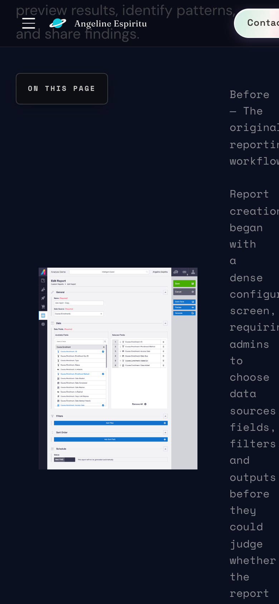
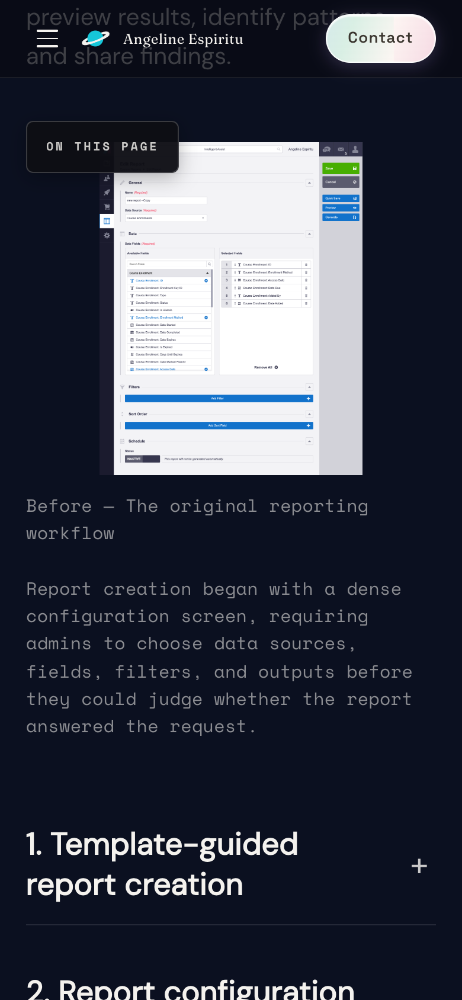
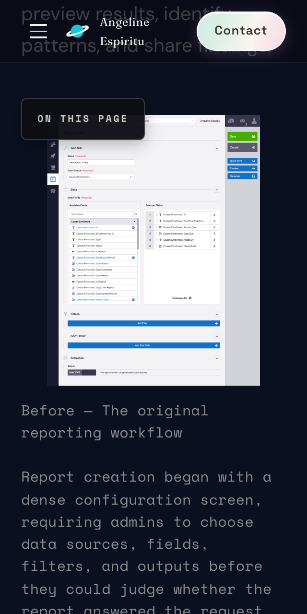

# Mobile compact-figure caption layout

**Retrospective — work completed October 2026.** This write-up documents an improvement already shipped on my portfolio; it is not a live build log of work in progress.

**Live case study:** [Diagnostic Learning Analytics](https://angelineespiritu.ca/work/diagnostic-learning-analytics) (scroll to the compact before/after figure in the case study body).

---

## The problem

On phone-sized viewports, **compact figures** in case studies (screenshot + caption meant to sit side by side on desktop) stayed a **two-column CSS grid**. The caption column shrank to a thin strip—**about 47px wide at 390px viewport** and **0px at 320px** in recorded captures—while the page gained **horizontal overflow** (up to **+122px** at 320px). Readers had to scroll sideways to read copy that should reflow like the rest of the case study.

**Why it mattered:** Case studies are core hiring material. Unreadable captions and sideways scrolling signal broken responsive design on the exact pages reviewers read closely.

**Cause:** `.notion-image--compact` uses `display: grid` with `grid-template-columns: 285px minmax(0, 1fr)`. Through **600px**, nothing changed that template to a **single column**, so the caption stayed in a narrow second column. A `@media (max-width: 900px)` block added `flex-direction: column`, which **does not apply to grid layout** (`flex-direction` is a flex property only). Properties like `gap` and `align-items` **can** apply to grid, but they did not replace the missing `grid-template-columns` change.

---

## How it was found and prioritized

**Cursor** ran a structured UX, accessibility, and responsive audit of my portfolio (Chrome, automated checks, and viewport captures). Among the confirmed layout defects, this one had a clear visual failure mode, a CSS-only fix in one file, and objective checks (caption width and horizontal overflow across viewport widths).

**I** chose to address this compact-figure issue as part of a focused responsive pass, with the design goal of **stacking image above caption** at the existing **`600px` breakpoint** and keeping the change **minimal** (no markup changes).

---

## Design decision and implementation

| | |
|---|---|
| **My decision** | At **≤600px**, stack the figure in a **single-column grid** (image centered above caption, **14px** row gap). Keep the **601px+** side-by-side layout. Leave the existing **900px** media-query block unchanged to limit diff scope. |
| **Cursor’s role** | Audit and evidence capture; implemented the CSS change; ran automated width sweeps; a **separate AI-assisted QA pass** (Playwright, Chrome, scripted checks) on the local app; prepared documentation. |
| **Unchanged** | Figure markup (`figure` / `figcaption` with compact classes) and enlarge/lightbox behaviour. |

**Before:** [css/compact-figure-excerpt-before.css](./css/compact-figure-excerpt-before.css)  
**After:** [css/compact-figure-excerpt-after.css](./css/compact-figure-excerpt-after.css)

```css
/* After — addition inside @media (max-width: 600px) */
.case-study-page .notion-image--compact {
  grid-template-columns: minmax(0, 1fr);
  justify-items: center;
  row-gap: 14px;
}
```

---

## Before and after (screenshots)

Captured on a **local development server** with Playwright and Chrome, diagnostic case study route, **before** the fix and **after** the fix. **Production has not been re-captured or measured for this write-up.**

### 390 × 844

| Before | After |
|--------|--------|
|  |  |

Recorded before state: caption **47px** wide, **+52px** page horizontal overflow.

### 320 × 640

| Before | After |
|--------|--------|
|  |  |

Recorded before state: caption **0px** wide, **+122px** horizontal overflow.

---

## Results

A **separate AI-assisted QA pass** on the local app (not human manual testing) recorded **pass with caveats** for this caption fix: at **320px** and **390px**, one column with image above caption, **no horizontal page overflow**, caption widths **276px** and **346px** after the fix (vs **0px** and **47px** before in the same measurement pass). Other published case studies at **390px** and **1440px** showed **no new page overflow** attributed to this CSS change in the recorded regression sweep.

**Limitations:** Evidence is **local dev only**—**no production verification** on record. Browser, device, and accessibility coverage were limited. See [VALIDATION.md](./VALIDATION.md) for breakpoint screenshots, full measurement tables, caveats, and pre-existing issues noted in QA.
