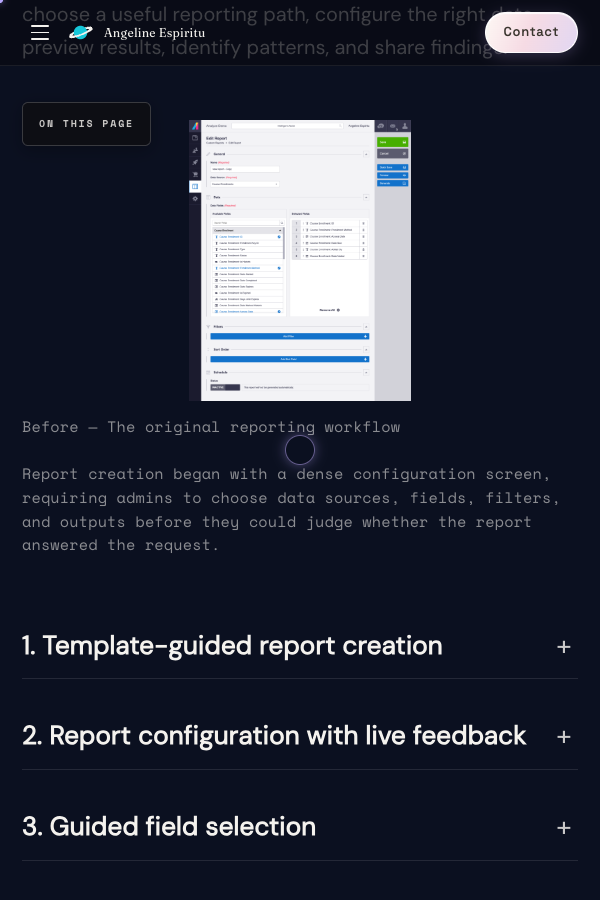
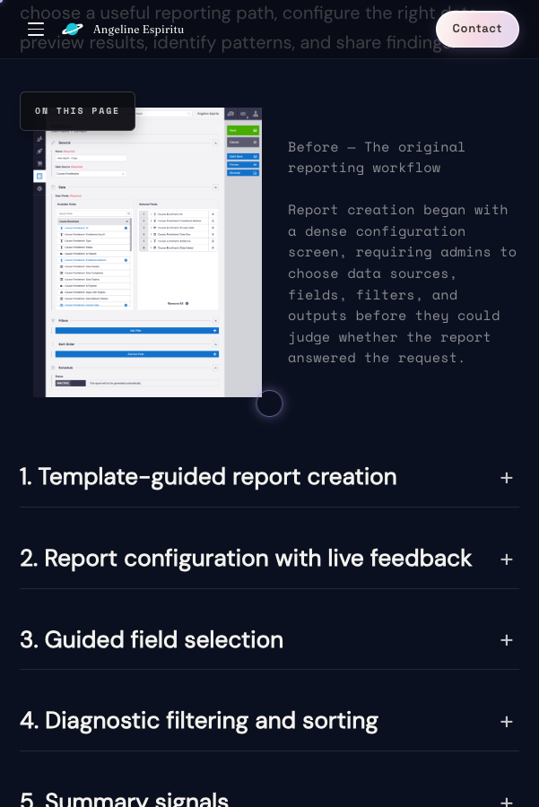

# Validation — mobile compact-figure caption

Supporting detail for [README.md](./README.md). All data below comes from recorded **AI-assisted QA** (October 2026): Cursor ran Playwright driving Chrome against `http://localhost:3000/work/diagnostic-learning-analytics`, plus viewport screenshots in `./assets/`. This was **not** a separate human manual test pass.

## Method

- **Before/after screenshots:** Scroll to the first `figure.notion-image--compact`, wait for lazy-loaded image, capture viewport PNG.
- **Width sweep:** Resize viewport across many widths (approximately 300–1920px); measure caption bounding box width and `document.documentElement.scrollWidth - clientWidth`.
- **Regression:** Same sweep on other published case study routes; compare layout fingerprints before vs after for this CSS deployment.
- **Follow-up QA pass:** Scripted checks (overflow, caption width, breakpoint behaviour, keyboard on compact trigger, axe on diagnostic page) documented as pass with caveats.

## Caption width and horizontal overflow (diagnostic case study)

| Viewport width | Caption width (before → after) | Page h-overflow (before → after) |
|----------------|--------------------------------|----------------------------------|
| 300 | 0 → 256 px | +142 → 0 |
| 320 | 0 → 276 px | +122 → 0 |
| 360 | 17 → 316 px | +82 → 0 |
| 375 | 32 → 331 px | +67 → 0 |
| 390 | 47 → 346 px | +52 → 0 |
| 414 | 71 → 370 px | +28 → 0 |
| 428 | 85 → 384 px | +14 → 0 |
| 480–600 | 137–257 → 436–556 px | 0 → 0 |
| 601–1920 | unchanged | unchanged |

At **≤600px**, caption position moved from beside the image to below it. From **601px** upward, the side-by-side grid band matched the pre-change measurements in this pass.

**Note on the table:** Overflow before the fix was worst at narrower widths (e.g. 300–428px). In this sweep, **480–600px** showed **0** horizontal overflow before the fix, while **390px** and below did not—both are from the same recorded pass.

## Breakpoint screenshots (after fix, local)

At **600px**, the figure stacks (single column):

At **601px**, the layout returns to side-by-side (intentional per design):

## AI-assisted QA verdict

**Pass with caveats — ready for design review.**

**Passed (caption-related):** Stacked layout at 320 and 390px; no horizontal overflow, overlap, or caption clipping at tested widths; breakpoint at 600px stacked / 601px side-by-side without overflow in recorded checks.

**Caveats:**

- **601–900px** remains side-by-side; at **601px** the caption was **~258px** wide (~10–11 lines)—readable in recorded checks but flagged for design review.
- A `width: min(100%, 320px)` caption rule **did not win** on specificity; measured caption widths at **390px** and **600px** were **wider than 320px** (e.g. **346px** at 390). This did **not** cause overflow in recorded checks, but the visual width may differ from the original CSS intent.
- **Not tested:** Safari, Firefox, real phones/tablets, screen readers, or zoom/reflow above 100%.

**Failed (pre-existing, not introduced by this caption change):** Compact-image dialog focus not trapped; axe `listitem` violations on diagnostic page lists.

**Out of scope but visible in screenshots:** Mobile “On this page” control overlapping content.

## Production

No post-deploy screenshot or measurement on https://angelineespiritu.ca is included in this evidence set.
