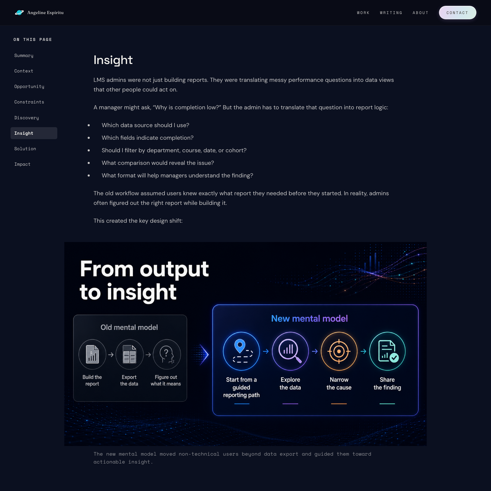
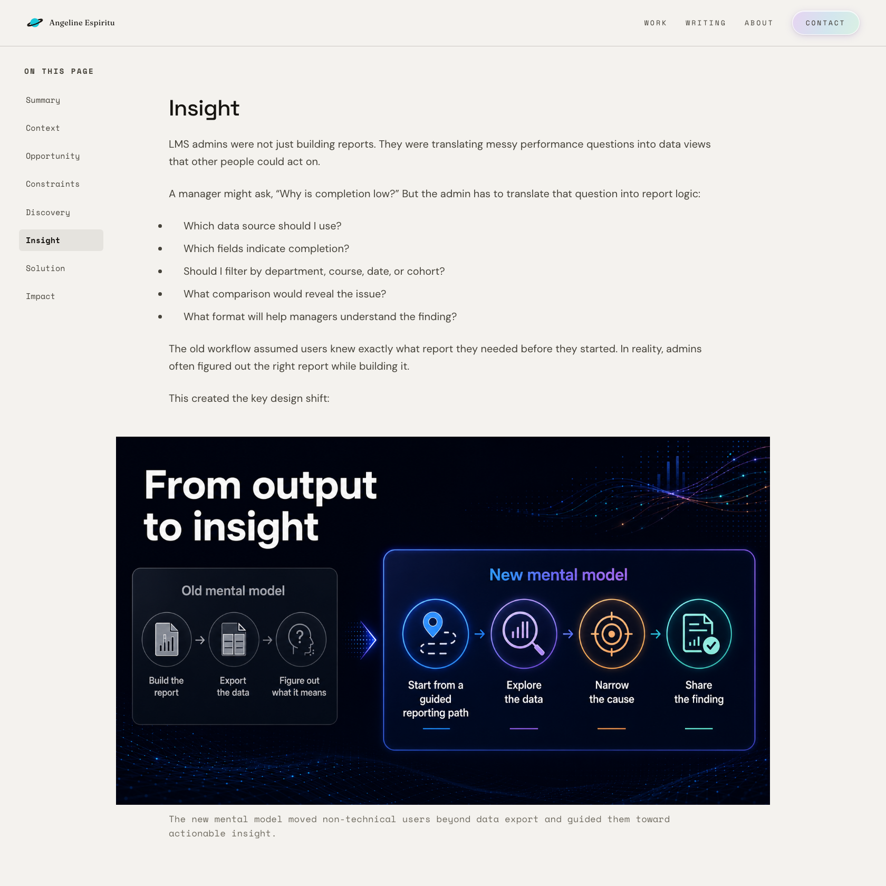
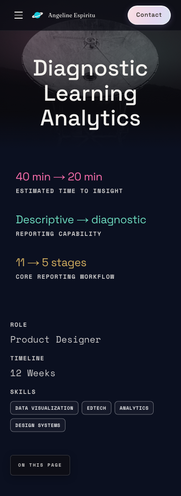
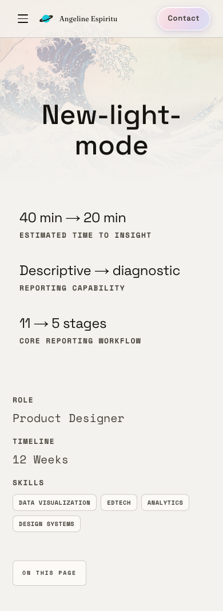
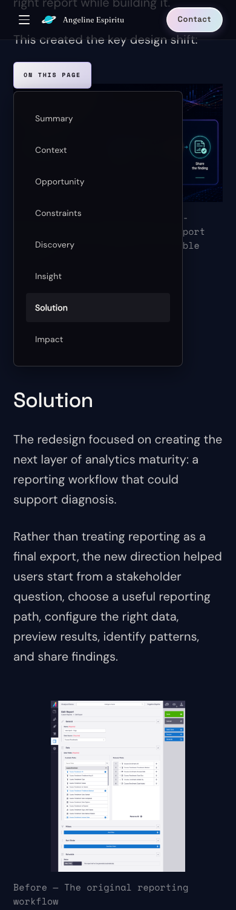
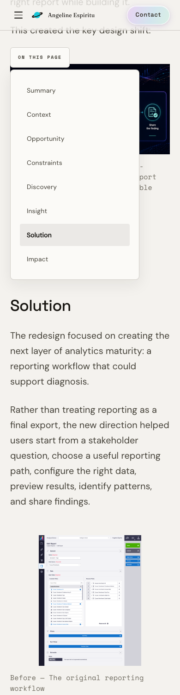

# Staged refresh: Theme consolidation

**Retrospective.** This write-up was published after the visual treatment was completed on 20 October 2026. The publication date is not the date that work was finished.

## Why I changed it

I am replacing the case studies in stages.

I separated the replacement case studies into a second Notion database, leaving the live site connected to the originals. This added a temporary content source to manage, but let me revise freely while recruiters continued seeing complete pages. It also preserved the detailed originals as reference material.

````mermaid
flowchart LR
    A["Original Notion database"] --> B["Production — live case studies"]
    C["Replacement Notion database"] --> D["Feature branch — local server and Vercel Preview"]
    E["Article database"] --> F["Article pages — unchanged"]

    classDef default fill:#272727,stroke:#888888,color:#EEEEEE,filter:none,box-shadow:none
    linkStyle default stroke:#88BECC
````

The live site continued reading the original case studies; branch previews and local development used the replacement database. Articles retained their existing content source.

With the live site protected, I established the light treatment on a copy of the Reporting case study. The shorter case studies come next. After that writing settles, I will refine typography and layout. Text length and structure change wrapping, spacing, and hierarchy, so those decisions should follow the content.

## Decisions and tradeoffs

I shared the homepage palette with the case studies instead of keeping a separate case-study palette. The homepage is warm off-white, with near-black text and a slightly lighter surface for cards.

I limited the recolor to case studies. Articles shared some of their styles, so I separated the theme colors while preserving the articles’ dark hero and navigation. This let the case studies adopt the homepage palette without turning the change into a site-wide redesign.

Changing the background required reassessing text contrast, accents, transparency, and controls. Accent colors used for text on the dark page did not provide sufficient contrast on the new off-white background, so I reassigned those elements to the established dark text colors.

I kept the outcome metrics in the homepage’s dark text colors for contrast, while retaining color selectively in supporting accents. For the contents hover marker, I reused an existing muted blue that complemented the light background. I shared its definition between the existing component and the contents marker, avoiding another color value to maintain.

The navigation adopted the same light treatment, with dark icons and links against the off-white background. I kept its structure and behavior, adjusting its appearance for readability rather than introducing another navigation design.

The browser icon is a minor consistency fix: the existing planet, with a dark ring, on every page. The navigation icons stayed as they were.

## What my review caught

On the first light pass, the mobile “On this page” button was transparent enough that the page showed through it. A contents control has to stay readable over whatever is behind it, so the resting and open states are an opaque warm surface, and the hover uses the dark fill and light text the homepage already uses.

Ascend’s hover did not match the homepage. The same control should behave the same way on both pages, so the case-study version uses the homepage’s dark ring at rest and its dark disc with a light arrow on hover.

## Comparison and verification

These frames compare the live Reporting page with the unreleased light replacement. The titles and covers differ: the live page is “Diagnostic Learning Analytics” with a photographic cover, and the replacement is the v2 pilot “New-light-mode” with an illustrated cover.

I checked contrast on the light pilot and checked that the page did not scroll sideways at the widths I tried.

### Desktop, Insight

Live site before. Sidebar visible, Insight selected. The diagram and its caption are fully in the frame.



Replacement preview. Same section and alignment.



### Mobile hero, contents closed

Live site before. The contents button is closed, so the hero stays clear.



Replacement preview.



### Mobile Solution, contents open

Live site before. The panel is open and Solution is selected.



Replacement preview. Same section selected.



## How I worked

I set the sequence above, chose the shared homepage palette, and reviewed the first light pass for controls that no longer worked on the light page. I delegated the implementation, the contrast and layout checks, and these captures to Cursor, then reviewed the replacement and accepted this pass.

The implementation is complete and is not yet released to the live website.
